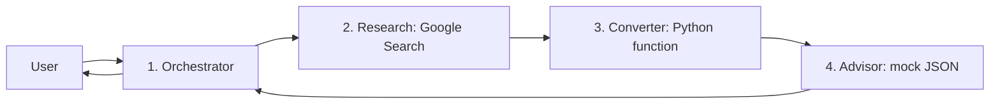

# Lab14: Four-agent weather assistant

This lab extends **Lab11-agent-function-weather-tool-2**. Lab11 lets one agent
call weather and conversion functions. Lab14 splits the work across exactly four
Google ADK agents and adds advice from the supplied synthetic JSON dataset.

## Learning objectives

- Give each agent a specific responsibility.
- Use ADK Google Search to research weather.
- Register a separate Python conversion function as an agent tool.
- Pass all weather information through a fixed sequence of agent calls.
- Match weather to local mock advice without inventing missing records.

## The four agents

| Agent | Responsibility | Tool |
| --- | --- | --- |
| 1. `weather_orchestrator` | Talks to the user, starts the workflow, writes the final answer | `run_weather_pipeline` |
| 2. `research_agent` | Finds current Celsius temperature, humidity, conditions and sources | ADK `google_search` |
| 3. `converter_agent` | Adds Fahrenheit and Kelvin while preserving the weather record | `get_temperature_unit_conversion` |
| 4. `advisor_agent` | Adds advice from the local JSON file | `get_weather_advice` |



`workflow.py` implements these arrows with three awaited `AgentTool.run_async`
calls. Research output becomes converter input; converter output becomes advisor
input; the complete advisor result returns to the orchestrator. The workflow is
a Python function, **not a fifth agent**. AgentTool keeps specialist responses
inside the tool call so only the orchestrator answers the user. Search grounding
metadata is propagated, and source links are also carried in the weather record.

The call order is enforced in Python. Specialist tool usage is instructed in
each agent's prompt; as with other LLM tool-calling labs, live behavior should
be checked in a real run. No agent transfer is needed.

## Files

```text
Lab14-multiagent-weather-tool-3/
  README.md
  requirements.txt
  tests/test_weather.py
  weather_agent3/
    __init__.py
    .env.example
    config.py
    agent.py
    researcher.py
    converter.py
    advisor.py
    workflow.py
    get_temperature_unit_conversion.py
    get_weather_advice.py
    data/mock_weather_advisory_with_advice.json
```

## Setup and run (PowerShell)

Use Python 3.11 or newer. From the repository root:

```powershell
cd Lab14-multiagent-weather-tool-3
py -3.11 -m venv .venv
.\.venv\Scripts\python.exe -m pip install -r requirements.txt
Copy-Item weather_agent3/.env.example weather_agent3/.env
```

The environment template uses the same enterprise settings as Lab11:
`GOOGLE_GENAI_USE_ENTERPRISE=1`, project `jovial-coral-423517-h8`, and location
`global`. Use the same Google Cloud authentication setup as Lab11.
Keep `.env` private; the repository ignores it.
`GEMINI_MODEL` defaults to Lab11's `gemini-3.5-flash`; change it if necessary to
a model available to your account that supports Google Search and function calls.
The dependency is pinned to the installed ADK version used for local validation.

Start the ADK development UI **from this lab folder**:

```powershell
.\.venv\Scripts\adk.exe web
```

Open the local URL printed by ADK and select **weather_agent3**. Or use the CLI:

```powershell
.\.venv\Scripts\adk.exe run weather_agent3
```

Example prompts:

- `What is the weather in London, UK, right now? Include clothing advice.`
- `Check Toronto, Canada. Show Celsius, Fahrenheit, Kelvin, and humidity.`
- `Now check Sydney, Australia.`

Each request starts fresh research. If a location is ambiguous, the orchestrator
asks for clarification. Search may not provide every current observation; the
workflow reports incomplete data instead of supplying made-up values.

## Follow the data

The research record contains `city`, `temperature_celsius`, `humidity`,
`condition`, `normalized_condition`, `observed_at`, `sources`, and `notes`.
The converter adds `temperature_fahrenheit` and `temperature_kelvin`.
The advisor adds `advice`, including its status and matching record.

For a **synthetic demonstration**, 25 C, 82% humidity and rain becomes 77 F and
298.15 K. The advice tool selects the warm/rain record with 85% reference humidity:
“Warm and wet. Use light rain protection and breathable clothing.”
The final answer labels this advice as synthetic, and includes the actual
research sources and observation time when available.

Conversion formulas live in the separate Python tool:

```text
Fahrenheit = Celsius * 9 / 5 + 32
Kelvin = Celsius + 273.15
```

## How mock advice is matched

The JSON is copied unchanged from `mock_weather_advisory_with_advice.json`.
It supplies **advice**, not live city weather.

1. Match the normalized condition: sunny, rain, snow, fog or thunderstorm.
2. Match the Celsius range using an inclusive lower bound and exclusive upper
   bound. The highest endpoint, 40 C, is included. Thus 10 C is mild, not cold.
3. Choose the candidate with the smallest humidity difference. Ties use file order.

Season is not inferred: no hemisphere assumption is made, and the returned
record's season is only dataset metadata. Reference humidity is used for matching
and never replaces the observed humidity. Cloudy/unknown conditions, temperatures
outside the dataset, and unsupported condition/range combinations return `no_match`.
Missing files and invalid numerical inputs return explicit errors.

## Verification

Run offline tests from this lab folder:

```powershell
.\.venv\Scripts\python.exe -m unittest discover -s tests -v
```

These check conversion, invalid inputs, advice boundaries, unsupported conditions,
the order and content of handoffs, and incomplete/malformed research. Agent
responses are mocked in workflow tests; they do not verify live search or Gemini.

For a live check, send a city prompt in ADK Web. Inspect the `run_weather_pipeline`
tool result for the research fields, both conversions, source links and advice.
Confirm the final answer is from `weather_orchestrator`, then ask about a different
city to check that fresh research occurs. Internal AgentTool runs are nested and
may not appear as separate chat messages in the UI.

If authentication or model access fails, check the Google Cloud credentials, project, selected model and
server log. Live requests require network access and may incur API charges.

## ADK references

- [Function tools and AgentTool](https://google.github.io/adk-docs/tools-custom/function-tools/)
- [Google Search tool](https://google.github.io/adk-docs/tools/gemini-api/google-search/)
